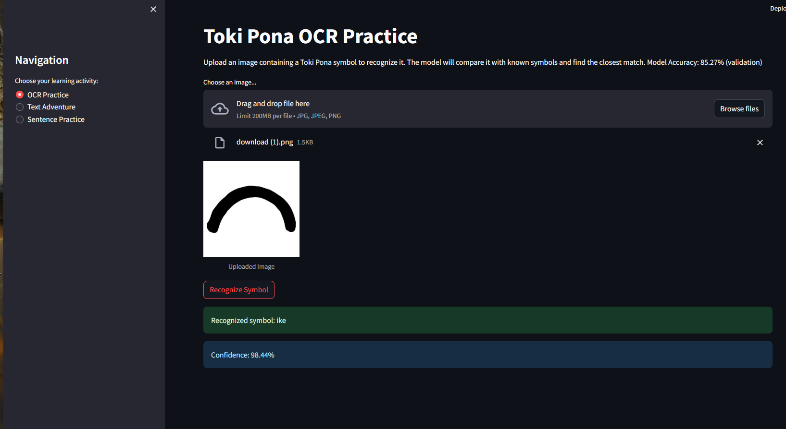
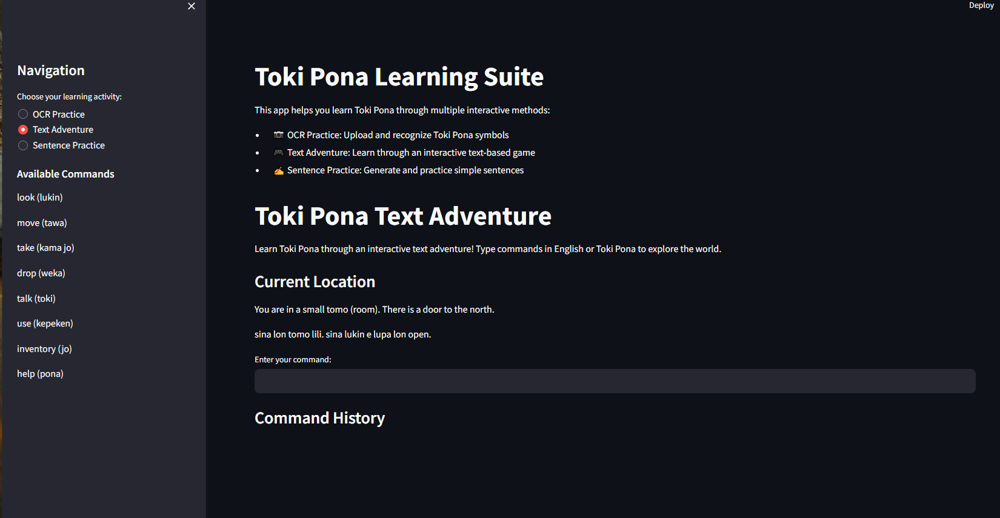

# Toki Pona Learning Platform

Interactive language learning platform for Toki Pona featuring OCR symbol recognition, text adventure game, and sentence construction practice.

## Demo Screenshots

| Feature | Screenshot |
|---------|------------|
| OCR Practice |  |
| Text Adventure |  |
| Sentence Practice |  |
| Example Sentence |  |

## Quick Start

**Prerequisites:** Python 3.8+, Git, CUDA-capable GPU (optional for faster training)

**Installation:**

```bash
# Clone repository
git clone https://github.com/JenMagruder/free-genai-bootcamp-2025.git
cd free-genai-bootcamp-2025/toki-pona-ocr

# Create virtual environment
python -m venv venv
source venv/bin/activate  # On Unix/MacOS
# venv\Scripts\activate   # On Windows

# Install dependencies
pip install -r requirements.txt

# Run application
streamlit run app/main.py
```

**Dependencies:** streamlit 1.32.0, torch 2.2.0, torchvision 0.17.0, numpy 1.24.3, Pillow 10.2.0, matplotlib 3.8.2 (see requirements.txt for full list)

**Troubleshooting:** CUDA errors will fall back to CPU. For module not found errors, activate virtual environment. For drawing issues, clear browser cache or use incognito mode.

## Features

**OCR Symbol Recognition (85.27% accuracy):** Draw Toki Pona symbols in browser with instant recognition results and confidence scores. Currently supports 11 common symbols: ike (bad), lili (small), ma (land), mi (I/we), moku (food), ona (he/she/it), pona (good), sina (you), suli (big), tawa (moving), tomo (house).

**Text Adventure:** Learn through interactive storytelling with vocabulary tracking, points for correct choices, and gradual difficulty progression.

**Sentence Constructor:** Build valid Toki Pona sentences with immediate feedback, common pattern practice, and example translations.

## Technical Architecture

**OCR Model:** Siamese Neural Network with ResNet34 backbone using PyTorch 2.2.0. Input is 224x224 RGB images, output is 512-dimensional embeddings. Trained on Google Colab GPU achieving 85.27% accuracy on test set.

**Web Interface:** Streamlit 1.32.0 with HTML5 Canvas drawing, Streamlit Sessions state management, and custom CSS styling.

## Performance

| Metric | Value |
|--------|--------|
| OCR Accuracy | 85.27% |
| Inference Time | 200ms |
| Memory Usage | 500MB |
| Supported Symbols | 11 |

## Project Structure

```
toki-pona-ocr/
├── app/
│   ├── main.py
│   ├── ocr_model.py
│   ├── ocr_practice.py
│   ├── text_adventure.py
│   └── sentence_practice.py
├── requirements.txt
└── README.md
```

## Development

**Tests:** `python -m pytest app/tests/`

**Style:** Follow PEP 8, use type hints, document all functions, keep line length ≤ 88 characters.

## Future Improvements

**LLM Integration:** Add GPT-4 for dynamic text generation, intelligent feedback, and personalized learning paths.

**Technical Enhancements:** Containerize with Docker, add comprehensive test suite, implement CI/CD pipeline.

**Feature Additions:** Speech recognition for pronunciation, more Toki Pona symbols, advanced sentence patterns.

## License

MIT License - See LICENSE file for details.

## Acknowledgments

Andrew Brown and ExamPro for the FREE GenAI Bootcamp, Toki Pona community for resources and feedback, all sponsors who made this possible.
